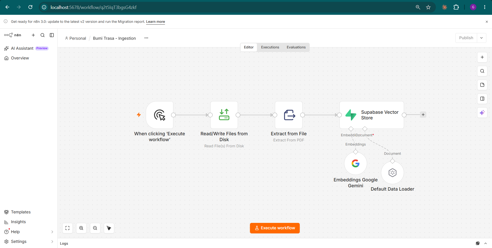
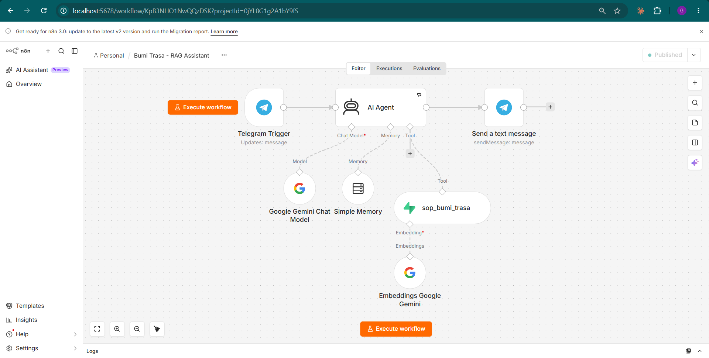
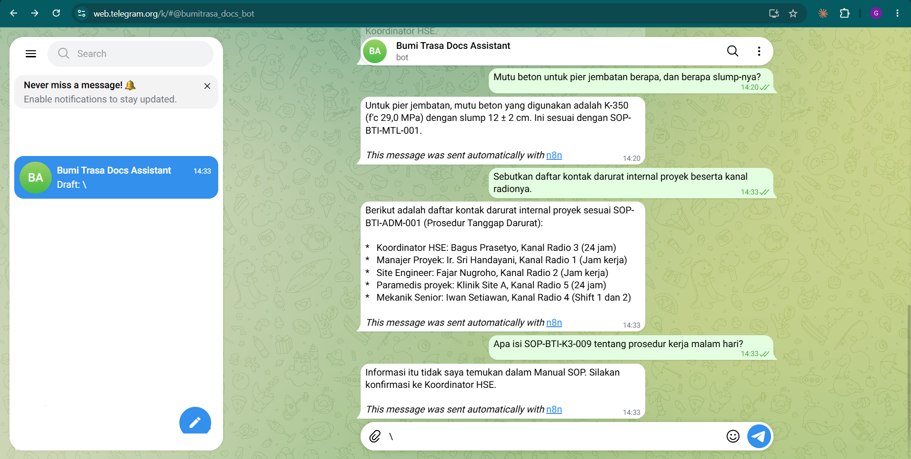
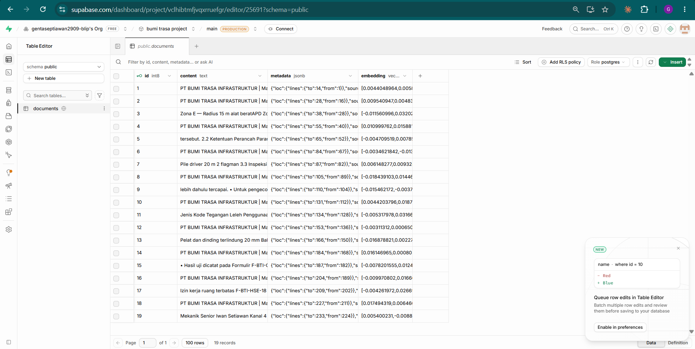

# Bumi Trasa RAG Assistant

AI document assistant that answers questions from a company's internal SOP manual — built with n8n, Google Gemini, Supabase pgvector, and Telegram.

> **Portfolio Project** — Demonstrates a production-shaped RAG (Retrieval-Augmented Generation) pipeline using no-code/low-code tooling.

---

## The Problem

Field teams at a construction contractor need fast answers from a 10-page SOP manual: which PPE is required in which zone, what concrete grade applies to bridge piers, which form to file for working-at-height permits, and by when.

A plain LLM chatbot fails here in a specific and dangerous way — it produces answers that *sound* authoritative but are invented. For safety documentation, a confident wrong answer is worse than no answer.

This project solves that by grounding every response in the actual document.

---

## How It Works

The system is split into two workflows with different lifecycles.

### Workflow A — Ingestion (run once per document)

```
Manual Trigger
  → Read/Write Files from Disk      (load the PDF)
  → Extract from File               (PDF → plain text)
  → Supabase Vector Store           (mode: Insert Documents)
      ├─ Default Data Loader        (chunk: 1000 chars, 200 overlap)
      └─ Embeddings Google Gemini   (gemini-embedding-001)
```

The 10-page manual becomes **19 chunks**, each stored with its 3072-dimension embedding vector.

### Workflow B — Retrieval (runs per user message)

```
Telegram Trigger
  → AI Agent
      ├─ Chat Model: Google Gemini 3.8 Flash
      ├─ Memory: Simple Memory (keyed by Telegram chat ID)
      └─ Tool: sop_bumi_trasa → Supabase Vector Store
                                   └─ Embeddings Google Gemini
  → Telegram: Send a text message
```

The agent decides when to search, embeds the user's question with the *same* model used at ingestion, retrieves the 4 most similar chunks, and answers only from what it finds.

**Separating the two workflows matters:** adding a new document never requires touching the bot.

---

## Screenshots

**Ingestion workflow** — PDF in, 19 embedded chunks out


**Retrieval workflow** — the vector store attached to the agent as a callable tool


**Live demo** — an accurate answer sourced from the manual, then an honest refusal when asked about a document that does not exist


**Vector store** — 19 chunks with their 3072-dimension embeddings


---

## Tech Stack

| Component | Choice | Why |
|---|---|---|
| Orchestration | n8n 2.36.8 (self-hosted) | Visual workflows, easy client handover |
| LLM | Google Gemini 2.5 Flash | Generous free tier |
| Embeddings | gemini-embedding-001 (3072-dim) | Same provider, no extra credential |
| Vector store | Supabase (Postgres + pgvector) | Free tier, SQL-native, widely adopted |
| Interface | Telegram Bot API | Zero-install for field users |
| Tunneling | ngrok | Webhook delivery to local n8n |

Total running cost: **$0**.

---

## Setup

### 1. Supabase

Create a project, then run this in the SQL Editor:

```sql
create extension if not exists vector;

create table documents (
  id bigserial primary key,
  content text,
  metadata jsonb,
  embedding vector(3072)
);

create function match_documents (
  query_embedding vector(3072),
  match_count int default null,
  filter jsonb default '{}'
) returns table (
  id bigint,
  content text,
  metadata jsonb,
  similarity float
)
language plpgsql
as $$
#variable_conflict use_column
begin
  return query
  select
    id,
    content,
    metadata,
    1 - (documents.embedding <=> query_embedding) as similarity
  from documents
  where metadata @> filter
  order by documents.embedding <=> query_embedding
  limit match_count;
end;
$$;
```

Grab the **Project URL** and **service_role key** from Settings → API Keys.

### 2. n8n

Start n8n with two environment variables:

```powershell
$env:N8N_RESTRICT_FILE_ACCESS_TO = "C:\path\to\your\pdf\folder"
$env:WEBHOOK_URL = "https://your-domain.ngrok-free.dev/"
n8n start
```

Both are required. See [Gotchas](#gotchas-worth-knowing) for why.

### 3. Import workflows

Import both JSON files from `Workflows/`, then set credentials:

- **Supabase API** — host + service_role key
- **Google Gemini(PaLM) API** — your API key
- **Telegram API** — bot token from @BotFather

Run Workflow A once to ingest the document, then publish Workflow B.

---

## Gotchas Worth Knowing

These cost real debugging time. Documented so they don't cost yours.

**Embedding dimensions must match the table exactly.**
`gemini-embedding-001` outputs **3072** dimensions. Most tutorials ship SQL with `vector(1536)` — an OpenAI-sized table. Mismatch produces: `expected 1536 dimensions, not 3072`. The n8n Gemini embeddings node exposes no dimension setting, so the table must adapt to the model, not the other way around.

**No vector index — and that's deliberate.**
pgvector caps HNSW and IVFFlat indexes at **2000 dimensions**, so a `vector(3072)` column cannot be indexed conventionally. At 19 chunks a sequential scan is instant. For a production corpus, the fix is `halfvec` (HNSW supports up to 4000 dimensions) via an expression index — at the cost of rewriting `match_documents` with matching casts.

**Ingestion and retrieval must use the same embedding model.**
Different models produce incompatible vector spaces. If the dimensions happen to match, there is no error — just quietly irrelevant results. This is the hardest RAG bug to diagnose, because nothing visibly breaks.

**n8n 2.x blocks filesystem access by default.**
The Read/Write Files node fails with `Access to the file is not allowed` until `N8N_RESTRICT_FILE_ACCESS_TO` names an allowed directory (semicolon-separated, directories not files).

**Telegram requires an HTTPS webhook.**
Without `WEBHOOK_URL` pointing at the tunnel, publishing fails with `An HTTPS URL must be provided for webhook`.

**Simple Memory needs an explicit session key with a Telegram trigger.**
Its default expects a Chat Trigger node. Set Session ID to *Define below* and key it on `{{ $('Telegram Trigger').item.json.message.chat.id }}` so conversations stay separated per user.

**Third-party APIs fail transiently.**
Gemini returns `503 Service Unavailable` under load. Retry On Fail (3 tries, 3s apart) is enabled on the AI Agent node — note that Retry On Fail exists only on main nodes, not on sub-nodes like the Chat Model.

**Model availability depends on the API key, not just the model name.**
`gemini-2.5-flash` returns `404 — no longer available to new users` on API keys created after Google's cutoff, while older keys keep working. The same model name therefore succeeds on one credential and fails on another in the same n8n instance — confusing until you notice the pattern. The newer replacement model was in turn unusable for a stretch, returning `503` under launch-week load, so this project runs 2.5 Flash on an older key.

**Telegram rejects the whole message on a malformed entity.**
LLM output containing `**bold**` breaks Telegram's legacy Markdown parser, which expects single asterisks: `can't parse entities: Can't find end of the entity starting at byte offset 388`. Fixed on two levels — Parse Mode set to HTML so asterisks are inert, and a system prompt instruction to emit plain text. Relying on the prompt alone is fragile; relying on the parse mode alone leaves literal asterisks in the output.

---

## Testing

Every test targets a fact that exists *only* in the source PDF — unguessable without retrieval.

| # | Question | Expected | Status |
|---|---|---|---|
| 1 | Minimum anchor point capacity for a full body harness? | 22 kN | PASS |
| 2 | Which form for a working-at-height permit, and the deadline? | F-BTI-HSE-12, 15:00 the day before | PASS |
| 3 | Concrete grade and slump for bridge piers? | K-350, f'c 29.0 MPa, slump 12 ± 2 cm | PASS |
| 4 | Who is the HSE Coordinator and on which radio channel? | Bagus Prasetyo, Channel 3 | PASS* |
| 5 | Contract value of the Cipali toll road project? | Must decline — not in the manual | PASS |
| 6 | Contents of SOP-BTI-K3-009 on night work procedures? | Must decline — this SOP does not exist | PASS |

Test 6 is the hallucination trap: it names a plausible but non-existent document, formatted exactly like the real SOP numbers. An ungrounded model invents its contents. Test ordering matters here — a refusal immediately following another refusal proves little, so test 6 was run directly after a successful answer.

**\* Test 4 failed on first run, and the failure was instructive.**

The bot replied "not found" for a fact that *is* in the manual. A direct SQL query confirmed the chunk existed (`select ... where content ilike '%Bagus Prasetyo%'` returned row 18), so this was a ranking problem, not an ingestion gap.

Two causes compounded. The phrase "HSE Coordinator" appears in five separate chunks — permit approvals, PPE sanctions, incident reporting — so the one chunk actually holding the contact table competed against four near-duplicates. That chunk also opens with the repeated page header, diluting its semantic signal.

Raising the retrieval limit from 4 to 8 fixed it. The deeper fix, left as future work, is stripping repeated page headers before chunking.

---

## Limitations

- Single document, manual ingestion. Scheduled or Drive-triggered ingestion would suit a real deployment.
- No vector index (see above) — fine at this scale, not at 100k chunks.
- No reranking. The top 4 chunks by cosine similarity go straight to the model.
- Chunking is fixed-size. Tables spanning a chunk boundary can lose their header row; semantic or layout-aware chunking would help.
- ngrok tunnel means the bot is only live while the local machine runs. Production would deploy n8n to a server.

---

## Why This Approach

Built with n8n rather than a Python/LangChain stack because the deliverable for a client is a workflow their own team can inspect, modify, and extend without a developer. Swapping the source document and system prompt retargets the entire system to a different industry — the same architecture already powers a retail customer service bot and a general construction assistant in companion projects.

---

## License

MIT
